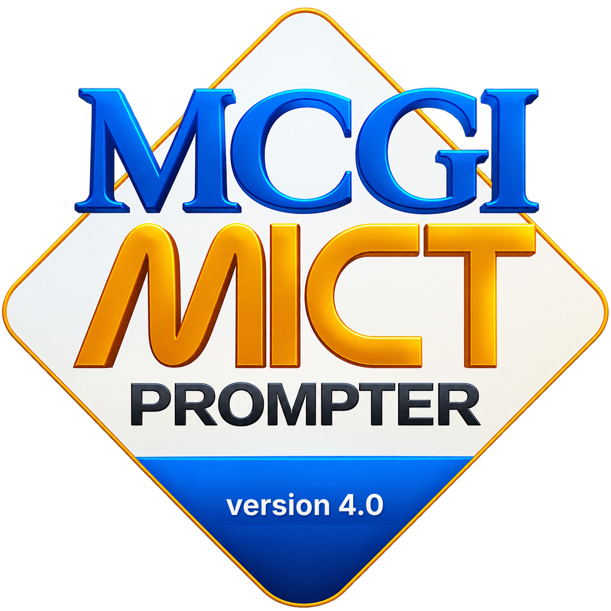

<p align="center">
  
</p>
MICT Teleprompter
A desktop lyrics and script prompter for live production. Build lyric slides, scroll them smoothly, and send a clean output to vMix, OBS or a second screen. Slides can even be written from a phone or another computer on the same Wi-Fi.
Created by me, John Laurence Tambor · MCGI Productions Southville. Built with Electron for Windows.
> App name: **MICT Lyrics Prompter** · Version **4.0.0**
---
Table of contents
Features
How it works
Project structure
Getting started
Using the app
Keyboard shortcuts
Web Teleprompter (use the Maker on another device)
Building the installer
Security notes
Repository notes
Credits
---
Features
Lyrics Scroller (main window)
Playlist of slides. Add images (+ Images) or text slides made in the Lyrics Maker (+ Manual Prompt).
Smooth auto-scroll up or down, with adjustable speed.
Display size control for different screens and projectors, with quick presets.
Clean Output window with no buttons, no scrollbar and no mouse cursor, made for capture in vMix or OBS. Press F on it for fullscreen.
Seamless live updates: when a slide that is on the output is edited in the Maker, the output updates in place. It does not restart and it does not pause.
Real text, not pictures: text slides stay sharp at any zoom or resolution.
Splash screen with the MICT logo on startup.
Lyrics Maker (Manual Prompt)
Type or paste lyrics or scripts, with a live preview.
Fonts: Georgia (default, embedded in the app), Times New Roman, Palatino Linotype, Cambria, Arial, Verdana, Tahoma, Trebuchet MS, Segoe UI, Calibri, Courier New.
Layout controls: font size, line spacing, left and right margin, top margin, alignment, bold.
Backgrounds: blue gradient (default), black (for scripts and teleprompter use), white, solid color, or your own image.
Automatic formatting:
Lines inside `( )` become italic.
Lines that contain a colon `:` turn yellow (color can be changed).
Text inside "quotation marks" turns blue (color can be changed).
Straight apostrophes between letters become curly (Kaya't becomes Kaya’t).
Update seamlessly (live): every keystroke or style change goes straight to the output.
Edit later: press the pencil button in the playlist to reopen any slide in the Maker.
Web Teleprompter
Use the Maker from a phone, tablet or laptop on the same network.
Protected by a 6-digit PIN.
Settings inside the app: turn it on or off, change the port, change the PIN.
---
How it works
```
                    ┌──────────────────────────────────────────────┐
                    │  Electron app (this PC)                      │
                    │                                              │
  Splash screen ──► │  Main window: lyrics_scroller_mict.html      │
                    │      │  window.open + postMessage            │
                    │      ├──► Output window  (for vMix / OBS)    │
                    │      └──► Lyrics Maker   (popup)             │
                    │                                              │
                    │  remote-server.js  (HTTP + SSE, PIN)         │
                    └───────────────▲──────────────────────────────┘
                                    │ same Wi-Fi / LAN
                          Phone or laptop browser
                          (Lyrics Maker over Wi-Fi)
```
On the same PC, the Maker and the Output window talk to the main window with `window.open` and `postMessage`.
For other devices, `remote-server.js` serves the Maker over HTTP. The device sends slides with `POST /api/send` and receives replies through a live stream (`/api/events`). The server passes messages to the main window over Electron IPC.
Anything that arrives over the network is cleaned and rebuilt before it is shown (only plain text lines and colors are kept).
---
Project structure
```
MICT-Teleprompter/
├── main.js                      Electron main process: splash, main window, popups, starts the remote server
├── remote-server.js             Web Teleprompter server (LAN only, PIN protected, no extra packages)
├── lyrics_scroller_mict.html    Main app: playlist, controls, preview, and the Output window
├── lyrics_maker.html            Lyrics Maker (also served to other devices by the remote server)
├── splash.html                  Splash screen shown on startup
├── MICT-Logo-PROMPTER.png       Logo (splash screen and this README)
├── MICT-MICT.ico                App and installer icon
├── backup.html                  Backup copy of an earlier version of the scroller
├── package.json                 App info, scripts, and electron-builder settings
├── package-lock.json
├── node_modules/                Generated by npm install (not committed)
└── dist/                        Generated by electron-builder (not committed)
    ├── MICT Lyrics Prompter Setup 4.0.0.exe
    └── win-unpacked/
```
> `lyrics_scroller_mict.html` opens `lyrics_maker.html` by file name, so the two files **must stay in the same folder**.
---
Getting started
Requirements
Windows 10 or 11 (x64)
Node.js (LTS) and npm
Run from source
```bash
npm install
npm start
```
`npm start` runs `electron .`. The splash screen appears first, then the main window.
---
Using the app
Create a slide. Click + Manual Prompt, type or paste your lyrics, choose the font, size, margins and background, then click Add to Playlist.
Or add images. Click + Images to load slide images from your computer.
Open the output. Click Open Output Window. Drag it to your second monitor, or capture it in vMix or OBS. Press F on it for fullscreen.
Scroll. Press ↓ to scroll down, ↑ to scroll up, and Space to stop. Adjust the speed and display size as needed.
Edit while live. Reopen a slide with the pencil button. Turn on Update seamlessly (live) in the Maker to send every change straight to the output, or press Update Slide when you are ready.
Tips
Choose the Black background for scripts and teleprompter use. The text color switches to white automatically.
Adding a new slide never changes what is currently on the output. A slide only goes live when you click it in the playlist, or when you start live editing it.
The playlist is kept in memory only, so it resets when the app closes.
---
Keyboard shortcuts
Where	Key	Action
Main window	↓ / ↑	Start scrolling down / up (press again to stop)
Main window	Space	Stop scrolling
Main window	+ / −	Faster / slower
Main window	F1 – F4	Display size 75% / 100% / 125% / 150%
Output window	F	Toggle fullscreen
Output window	↓ / ↑ / Space / + / −	Same scroll controls as the main window
Holding ↓, ↑ or Space does not repeat the action.
---
Web Teleprompter (use the Maker on another device)
Write and edit slides on a phone or laptop while the prompter runs on the PC.
Start the app on the PC. In the sidebar under the playlist, click Web Teleprompter to show the link, for example `http://192.168.1.20:8787/?pin=482913`.
Open that link in the browser of your phone or laptop. It must be on the same Wi-Fi or LAN.
The Maker loads and connects. Use Add to Playlist, or turn on Update seamlessly (live) to type straight to the output.
Open ⚙ Settings inside Web Teleprompter to:
turn the server on or off,
change the port (default `8787`, the next free port is used if it is busy),
change the PIN (or press New for a random one).
Saving restarts the server. Devices that were connected must open the link again.
Good to know
On the first run, Windows Firewall will ask for permission. Choose Private networks.
Guest Wi-Fi with "client isolation" blocks the connection.
It works on the local network only, not over the internet. Traffic is plain HTTP, so use it on a network you trust.
If the PC's IP address changes, use the new link shown in the app.
Settings are saved in the app data folder (`remote-settings.json`).
---
Building the installer
```bash
npm run dist
```
This runs `electron-builder --win nsis` and creates the installer in `dist/`:
```
dist/MICT Lyrics Prompter Setup 4.0.0.exe
```
Installer settings (from `package.json`):
Setting	Value
App ID	`com.lyricsscroller.mict`
Product name	MICT Lyrics Prompter
Target	NSIS, Windows x64
Icon	`MICT-MICT.ico`
Install	Not one-click, user can choose the folder, desktop and Start Menu shortcuts
Make sure `lyrics_maker.html`, `remote-server.js`, `splash.html`, `MICT-Logo-PROMPTER.png` and `MICT-MICT.ico` are included. The default `files` setting (`**/*`) already includes them.
---
Security notes
Every request to the Web Teleprompter needs the PIN. Eight wrong tries lock a device out for one minute.
Slides received over the network are rebuilt from scratch. Only plain text lines and colors are kept, so no script from the network can run in the app.
The Maker and Output popups have no Node.js access.
Requests are limited to 30 MB.
---
Repository notes
Suggested `.gitignore`
```gitignore
node_modules/
dist/
```
The installer in `dist/` is about 97 MB, which is close to GitHub's 100 MB file limit. Upload it to GitHub Releases instead of committing it.
`package.json` lists `bcryptjs`, `better-sqlite3`, `express`, `jsonwebtoken` and `socket.io`, but the current code does not use them. They can be removed with `npm uninstall` to make the installer smaller.
---
Credits
I'm John Laurence Tambor who created this project. I came up with the idea, decided on every feature, tested it, and prepared the branding and packaging.
I built it with AI assistance
Uses Electron and electron-builder. Georgia is a Microsoft font and is embedded in the app (subset) for consistent display.
License
No license has been added yet. Add a `LICENSE` file if you plan to share or reuse this project publicly.
